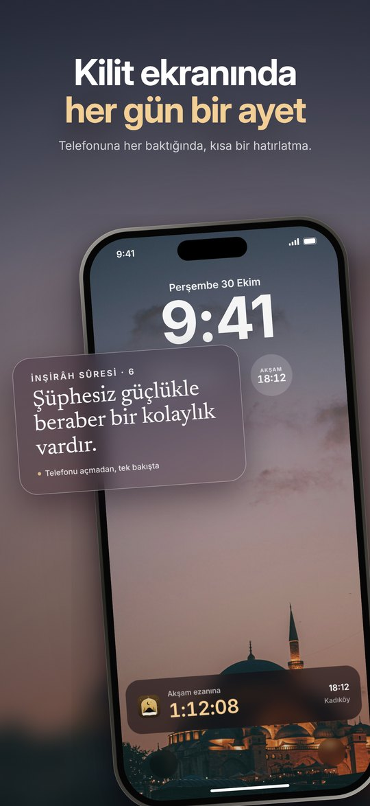
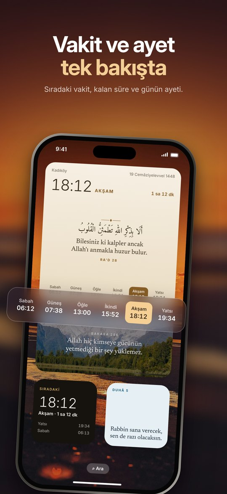
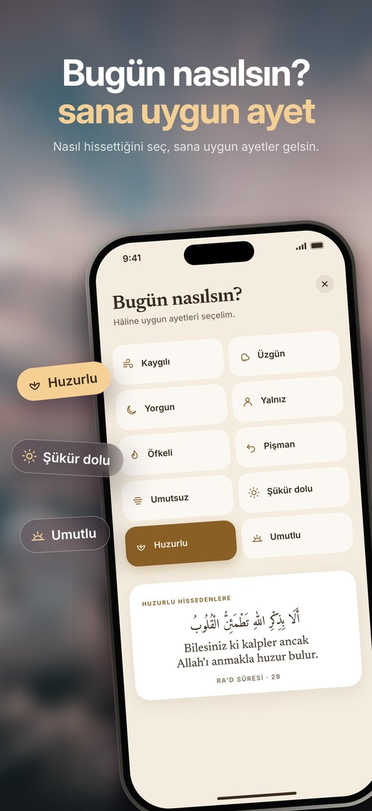
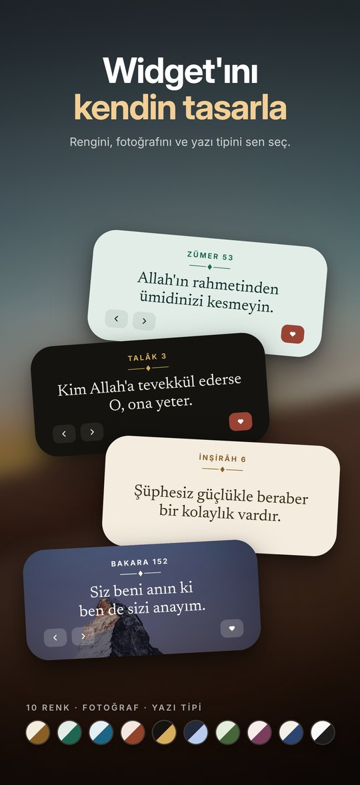
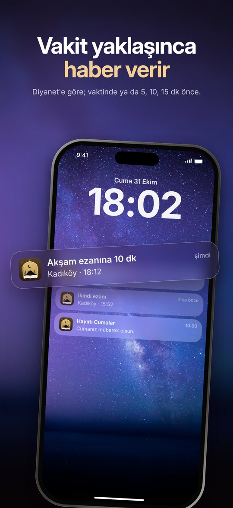
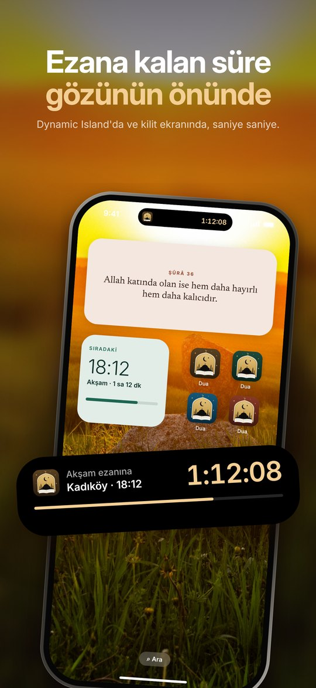
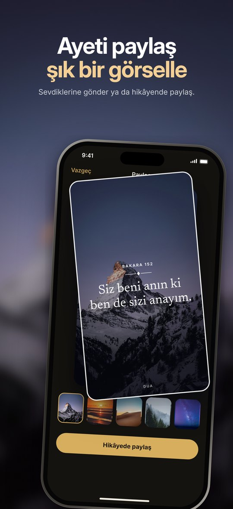
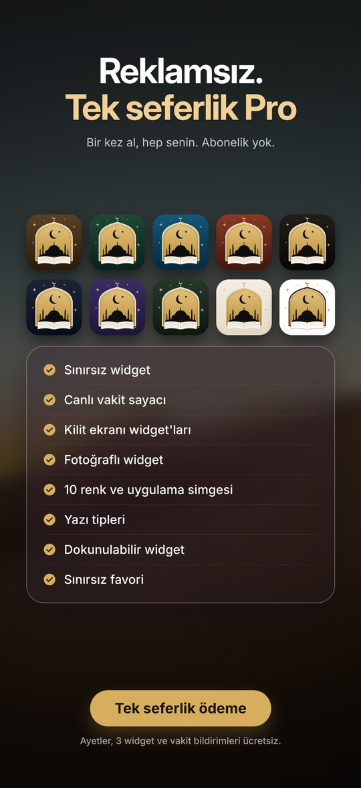
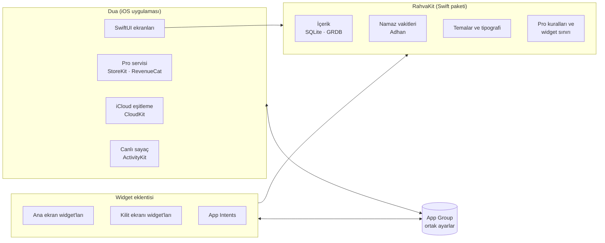

  

  <b>Kilit ekranında her gün bir ayet.</b> 
  Namaz vakitleri, ezan bildirimleri ve sade widget'lar; reklamsız, abonelik yok.

  
  
  
  
  

---

## Dua nedir?

**Dua**, telefonunu her açtığında seni bir ayetle karşılayan bir iOS uygulaması. Ana ekran ve kilit ekranı widget'ları gün içinde kendiliğinden yenilenen ayetler gösterir; konumuna göre hesaplanan namaz vakitleri, ezan bildirimleri ve Dynamic Island'daki canlı sayaçla günün akışına sessizce eşlik eder.

Uygulamayı tek başıma; fikirden tasarıma, kodlamadan App Store yayınına kadar uçtan uca geliştirdim.

## Ekran görüntüleri

<table>
  <tr>
    <td></td>
    <td></td>
    <td></td>
    <td></td>
  </tr>
  <tr>
    <td></td>
    <td></td>
    <td></td>
    <td></td>
  </tr>
</table>

## Özellikler

### 📖 Ayet widget'ları
- Ana ekran (küçük, orta, büyük) ve kilit ekranı için widget'lar
- Ayetler gün içinde kendiliğinden yenilenir
- Widget düzenleyici: tema rengi, fotoğraflı arka plan, yazı tipi, boyut ve satır aralığı
- Türkçe meal ve isteğe bağlı Arapça metin
- Dokunulabilir widget: ayeti widget'tan değiştir ya da favorilere ekle (App Intents)

### 🕌 Namaz vakitleri
- Konuma göre cihazda hesaplanan vakitler; istersen konum yerine şehir seçimi
- Sıradaki vakit, kalan süre ve hicrî tarih widget'ta
- **Namaz + Ayet** birleşik widget'ı
- Ezan bildirimi: vaktinde ya da 5, 10, 15 dk önce
- Cuma, kandil, bayram, Ramazan'da sahur ve iftar bildirimleri
- İmsakiye ve kıble pusulası

### ⏱️ Canlı vakit sayacı
- Dynamic Island'da ve kilit ekranında saniye saniye ezana kalan süre (ActivityKit)

### 💭 Ayet akışı
- Huzur, umut, sabır, şükür gibi konulara göre bir akış
- **"Bugün nasılsın?"**: o anki hâline uygun ayetler
- Favoriler ve iCloud ile cihazlar arası eşitleme

### 🖼️ Paylaş
- Ayeti hikâye ya da gönderi için şık bir karta dönüştür

### 🔒 Gizlilik
- Hesap yok, reklam yok, izleme ya da analiz aracı yok
- Vakitler telefonda hesaplanır; konum cihazdan çıkmaz

## Ücretsiz ve Pro

| | Ücretsiz | Pro (tek seferlik) |
|---|:---:|:---:|
| Ayetler, ayet akışı, "Bugün nasılsın?" | ✓ | ✓ |
| Namaz vakitleri, ezan bildirimleri, imsakiye, kıble | ✓ | ✓ |
| Widget (kilit ekranı dahil) | 3 adet | Sınırsız |
| Pro kilit ekranı widget'ları: vakit listesi, geri sayım, hicrî takvim | | ✓ |
| Canlı vakit sayacı (Dynamic Island) | | ✓ |
| Fotoğraflı ayet widget'ı | | ✓ |
| Widget'tan ayet değiştirme ve favorileme | | ✓ |
| Tüm renkler, yazı tipleri ve uygulama simgeleri | | ✓ |

Pro **abonelik değil**: bir kez satın alınır. Yeni kullanıcılar 3 gün ücretsiz dener; deneme bitince otomatik ücret alınmaz.

## Teknik altyapı

| Alan | Kullanılan |
|---|---|
| Arayüz | SwiftUI |
| Widget'lar | WidgetKit · ana ekran ve kilit ekranı aileleri (`accessoryRectangular`, `accessoryCircular`, `accessoryInline`) |
| Etkileşim | App Intents · yapılandırılabilir ve dokunulabilir widget'lar |
| Canlı sayaç | ActivityKit · Live Activities ve Dynamic Island |
| Namaz vakitleri | [Adhan](https://github.com/batoulapps/adhan-swift) · tamamen cihazda hesaplama |
| İçerik veritabanı | SQLite + [GRDB](https://github.com/groue/GRDB.swift) · 114 sûre, 1.098 seçilmiş ayet, 15 konu |
| Eşitleme | CloudKit (iCloud özel veritabanı) · favoriler, widget ayarları, tema |
| Satın alma | StoreKit + RevenueCat · tek seferlik ürün ve 0 TL'lik deneme ürünü (App Store kuralı 3.1.1) |
| Paylaşılan veri | App Group · uygulama ve widget aynı ayarları ve Pro durumunu okur |
| Deneme koruması | Keychain + App Store kaydı · silip yükleyince deneme baştan başlamaz |

### Mimari

Uygulama ve widget eklentisi ortak çekirdeği yerel bir Swift paketinde (**RahvaKit**) paylaşır: içerik, namaz vakti hesabı, temalar ve Pro kuralları tek yerde tutulur. Widget'lar App Group üzerinden uygulamayla aynı ayarları okur. Ücretsiz plandaki widget sınırı, iOS'un ekrandaki tüm widget yapılandırmalarını sayan `WidgetCenter` API'siyle uygulanır.

## Tasarım yaklaşımı

- **Sadelik önce:** her ekran tek bir işi yapar. Ayarlar az, varsayılanlar iyi.
- **Saygılı bildirimler:** sık ayet bildirimi yok. Yalnızca vakit, Cuma ve özel günler.
- **Dürüst satış:** abonelik yok, karanlık desen yok. Deneme bitince neyin ücretsiz kaldığı açıkça söylenir; denemede kurulan ayarlar saklanır.
- **Kimlik:** altın kemer simgesi, siyah-beyaz ana tema ve 10 renk seçeneği; açık ve koyu görünüm.

## Yol haritası

- [x] 1.0 · App Store'a gönderildi
- [ ] 1.0.1 · İlk düzeltmeler ve bugfixing
- [ ] Apple Watch uygulaması
- [ ] İngilizce arayüz

## Kaynaklar

- Türkçe meal: Diyanet İşleri Başkanlığı
- Arapça metin: [Tanzil Projesi](https://tanzil.net)
- Namaz vakti hesabı: [Adhan](https://github.com/batoulapps/adhan-swift)

## Bu depo hakkında

Bu depo, uygulamanın tanıtım sayfasını ve yasal sayfalarını barındırır. Uygulamanın kaynak kodu kapalıdır.

- [Gizlilik Politikası](https://burakcolay.github.io/Dua-Ayet-Widget-Ezan-Vakti-IOSAPP/gizlilik.html)
- [Kullanım Şartları](https://burakcolay.github.io/Dua-Ayet-Widget-Ezan-Vakti-IOSAPP/kullanim-sartlari.html)
- [Destek](https://burakcolay.github.io/Dua-Ayet-Widget-Ezan-Vakti-IOSAPP/)

---

<b>🇬🇧 English</b>

 

**Dua** is an iOS app that greets you with a Quran verse every time you unlock your phone. Home Screen and Lock Screen widgets show verses that refresh throughout the day, alongside on-device prayer times, adhan notifications and a live prayer countdown in the Dynamic Island. No ads, no account, no subscription.

**Highlights**
- Verse widgets for the Home Screen and Lock Screen, with a built-in widget editor (theme, photo background, font)
- On-device prayer time calculation (Adhan), adhan notifications, Ramadan timetable and Qibla compass
- Live prayer countdown with ActivityKit and the Dynamic Island
- Mood-based verse suggestions ("How are you today?")
- iCloud sync via CloudKit; one-time Pro purchase with a 3-day free trial (StoreKit + RevenueCat)

**Stack:** SwiftUI · WidgetKit · App Intents · ActivityKit · CloudKit · StoreKit · SQLite/GRDB · Adhan · App Groups · a local Swift package (RahvaKit) shared between the app and the widget extension.

Designed, built and shipped end to end by a solo developer. The app is currently Turkish only. This repository hosts the app's landing and legal pages; the source code is private.

   
  <b>Burak Colay</b> · CodeGrid

